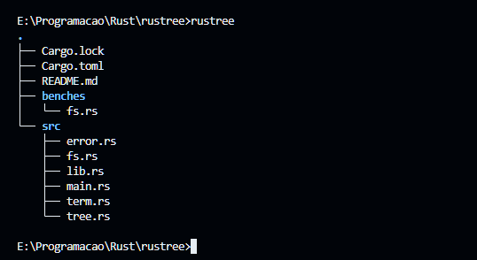

# rustree

A Rust implementation of the `tree` command-line utility. It's not blazingly fast (yet), but at least it respects `.gitignore` files by default.



## Installation

### CLI

```bash
cargo install --git https://github.com/DarkCeptor44/rustree
```

Or grab a binary from [releases](https://github.com/DarkCeptor44/rustree/releases).

### Library

```bash
cargo add --git https://github.com/DarkCeptor44/rustree --no-default-features
```

Or:

```toml
[dependencies]
rustree = { version = "0.1.0", git = "https://github.com/DarkCeptor44/rustree", default-features = false }
```

## MSRV

The minimum supported Rust version is:

| Version | Edition | MSRV |
| --- | --- | --- |
| `<= 0.1.0` | 2024 | 1.95.0 |

## Usage Example

```rust
use rustree::{Node, Walker, insert_entry, render_tree};
use std::{collections::BTreeMap, path::Path};

let root = Path::new(".");
let entries = Walker::new(root).threshold(100).all(false).walk();

// if you want to use ignore, this crate already provides
// a From<ignore::DirEntry> for DirEntry.
// if you want to use another crate for directory traversal,
// it's pretty easy to convert a DirEntry to a rustree::DirEntry,
// all you need is a PathBuf.

let mut root_map: BTreeMap<String, Node> = BTreeMap::new();
for entry in entries {
    insert_entry(&mut root_map, root, &entry, true);
}

render_tree(root, &root_map, false, "blue", true);
```

## Todo

- [ ] Make it faster
- [ ] Depth limiting
- [ ] Directories-only mode

## Benchmarks

- **Command:**:

    ```bash
    hyperfine --warmup 10 "tree" --command-name "Windows tree" "rustree -a" --command-name "rustree (all)" "rustree -l" --command-name "rustree (with sizes)" "rustree" -S --export-markdown=windows.md
    ```

### Rust Codebase

- **2.6M lines of code**

| Command | Mean Wall Time [ms] | Change | Factor |
| --- | --- | --- | --- |
| `Windows tree` | 469.3 ± 63.2 | | |
| `rustree` | 641.3 ± 7.5 | +36.7% | (1.4x slower) |
| `rustree (all)` | 666.7 ± 45.8 | +42.1% | (1.4x slower) |
| `rustree (with sizes)` | 6292.6 ± 219.7 | +1240.9% | (13.4x slower) |

### Rustree Codebase

- **170 lines of code**

| Command | Mean Wall Time [ms] | Change | Factor |
| --- | --- | --- | --- |
| `rustree` | 14.7 ± 1.2 | -8.3% | |
| `rustree (with sizes)` | 15.6 ± 1.6 | -2.2% | |
| `Windows tree` | 16.0 ± 4.8 | | |
| `rustree (all)` | 35.7 ± 1.4 | +123.1% | (2.2x slower) |

### Library Benchmarks

```text
Timer precision: 100 ns
fs               fastest       │ slowest       │ median        │ mean          │ samples │ iters
╰─ Walker::walk                │               │               │               │         │
   ├─ 100        2.933 ms      │ 4.09 ms       │ 3.063 ms      │ 3.16 ms       │ 100     │ 100
   │             34.09 Kitem/s │ 24.44 Kitem/s │ 32.64 Kitem/s │ 31.63 Kitem/s │         │
   ├─ 500        12.93 ms      │ 16.16 ms      │ 13.64 ms      │ 13.94 ms      │ 100     │ 100
   │             38.65 Kitem/s │ 30.93 Kitem/s │ 36.63 Kitem/s │ 35.84 Kitem/s │         │
   ├─ 1000       18.97 ms      │ 23.9 ms       │ 19.88 ms      │ 20.06 ms      │ 100     │ 100
   │             52.7 Kitem/s  │ 41.82 Kitem/s │ 50.28 Kitem/s │ 49.83 Kitem/s │         │
   ╰─ 10000      107.8 ms      │ 151.4 ms      │ 118.6 ms      │ 119.8 ms      │ 100     │ 100
                 92.74 Kitem/s │ 66.01 Kitem/s │ 84.29 Kitem/s │ 83.4 Kitem/s  │         │
```

## Audits

| Auditor | Audit Date | Version | Vulnerabilities |
| --- | --- | --- | --- |
| [cargo-audit](https://crates.io/crates/cargo-audit) | 2026-10-29 | 0.1.0 | 0 |

## License

This project is licensed under the [Mozilla Public License, version 2.0](https://www.mozilla.org/en-US/MPL/2.0/). See the [LICENSE](./LICENSE) file for details.
